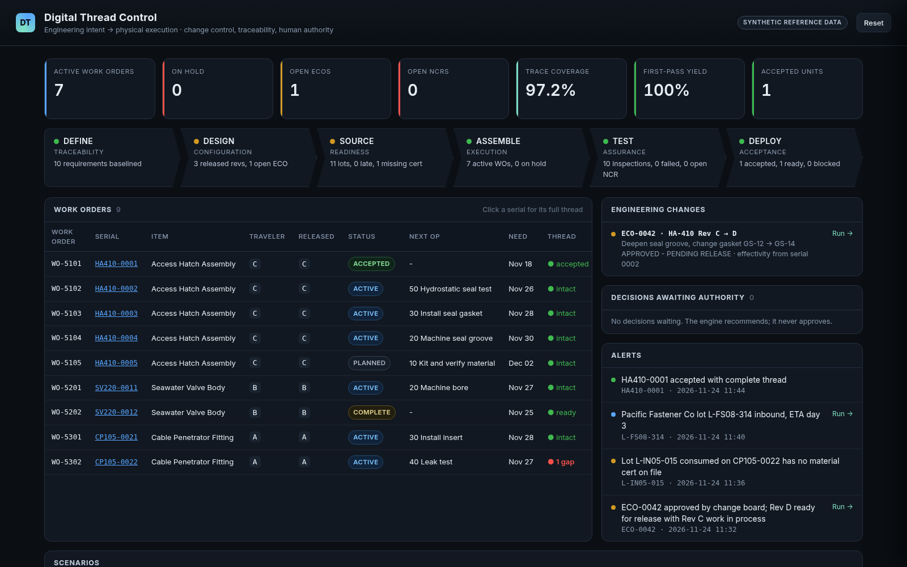
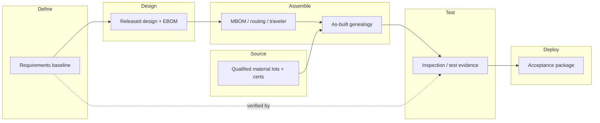
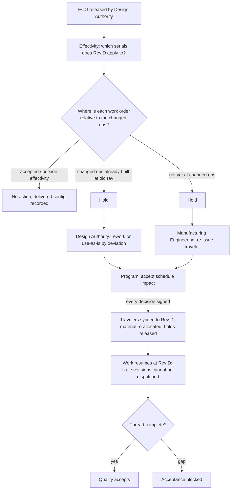
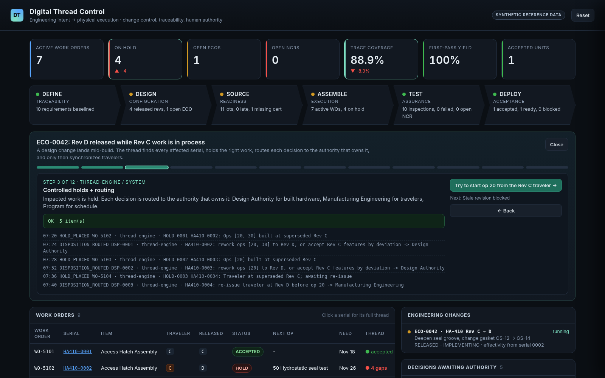
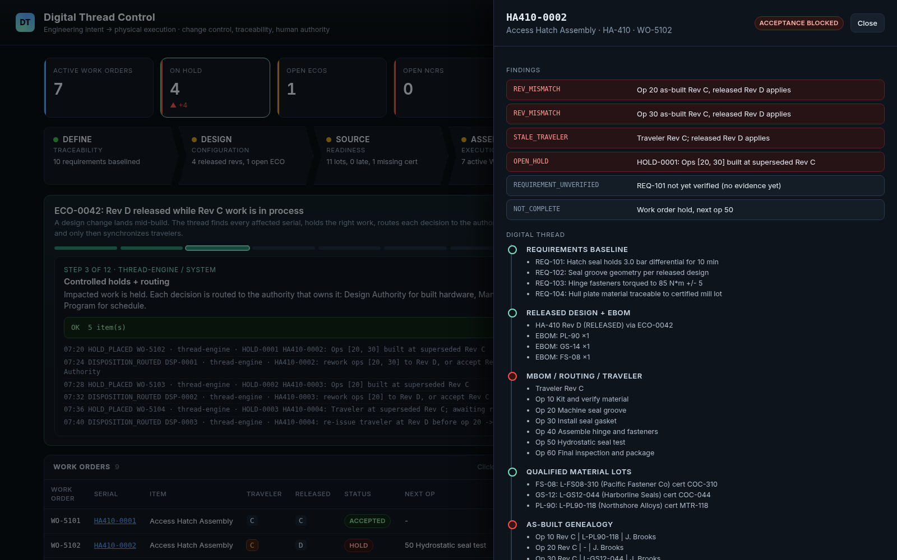

# Digital Thread Change Control

**Engineering intent → physical execution, with a human authority on every decision.**

A reference implementation of the part of a production system that usually breaks first: a design change released while older-revision work is already on the floor. It traces every serial from requirement to acceptance, finds what a change touches, holds the right work, routes each decision to the person who owns it, and only then synchronizes travelers. Acceptance is blocked while any thread gap is open.

**Live dashboard:** https://zionxai5000.github.io/digital-thread-change-control/ (static page, synthetic data, nothing to install)



## What it demonstrates

| Scenario | What happens |
|---|---|
| **Rev D released while Rev C is in work** (primary) | Effectivity and serial impact analysis, controlled holds, decisions routed to Design Authority / Manufacturing Engineering / Program, refusal of auto-approval and wrong-role signatures, traveler sync and material re-allocation, rework at the new revision, gated acceptance |
| **Inspection out of tolerance** | NCR opened automatically, unit held, MRB disposition (use-as-is needs Design Authority), re-inspection closes the NCR |
| **Supplier delay** | Late lot mapped to the work orders that need it, need-date misses, qualified alternate found, Program decides |
| **Physical-to-record mismatch** | Scanned lot ≠ MBOM allocation holds the unit; a consumed lot without a material cert blocks acceptance |

## The thread



## The change flow



## Quickstart

Python 3.10+, standard library only.

```bash
git clone https://github.com/zionxai5000/digital-thread-change-control
cd digital-thread-change-control
python -m dthread demo          # Rev D scenario in the terminal (or: demo ncr | supplier | mismatch | all)
python -m dthread trace HA410-0002
python -m dthread serve --open  # dashboard at http://127.0.0.1:8000
pip install pytest && python -m pytest -q
```

## Scenario walkthrough: Rev D

1. **Release.** Design Authority releases ECO-0042 (seal groove 6.00 → 6.40 mm, gasket GS-12 → GS-14). Five hatch serials exist at Rev C.
2. **Impact.** Effectivity starts at serial 0002. 0001 is accepted and stays Rev C. 0002 and 0003 have changed ops built at Rev C. 0004 and 0005 have not reached them.
3. **Hold and route.** Four work orders are held. Built hardware goes to Design Authority, travelers to Manufacturing Engineering, schedule to Program.
4. **Guardrails.** The floor cannot start op 20 from the Rev C traveler. The engine cannot approve its own recommendation. Quality cannot sign a Design Authority decision. Each refusal is logged.
5. **Decide.** Named people sign each disposition. Nothing syncs until the last one is signed.
6. **Synchronize.** Travelers move to Rev D, GS-14 is allocated, holds release, rework restarts at op 20.
7. **Accept.** Acceptance of 0002 is refused until rework is done, then passes with every requirement verified against Rev D evidence.




## Design principles

- **Human authority.** The engine analyses, holds, recommends and routes. It never approves. Each option on a disposition names the role allowed to choose it.
- **Effectivity.** A released revision applies to the serials its effectivity names; delivered configurations stay frozen.
- **Traceability.** Every serial walks requirement → released design → MBOM/traveler → certified lot → as-built op → inspection evidence → acceptance, and every gap is a named finding.
- **Auditability.** Every action, including refused ones, lands in an append-only log with actor, role and reason.
- **Fail closed.** Stale revisions, open holds, unreceived material and missing certs stop work or acceptance rather than warn.

## Layout

```
dthread/model.py      domain records (requirement, revision, lot, work order, ECO, hold, disposition, NCR, audit)
dthread/engine.py     change control, dispatch gates, inspection/NCR, supply replan, trace, KPIs
dthread/data.py       synthetic reference data
dthread/scenarios.py  scripted scenarios run against the real engine
dthread/web/          single-file dashboard template
docs/                 generated static dashboard (GitHub Pages) and screenshots
tests/                pytest suite
```

## Notes

All parts, serials, lots, suppliers and people are invented. This is a reference implementation of the control logic, not a production system; in practice the records would come from PLM, ERP, MES and QMS through their own interfaces.

---
Anthony Blow · MIT License
